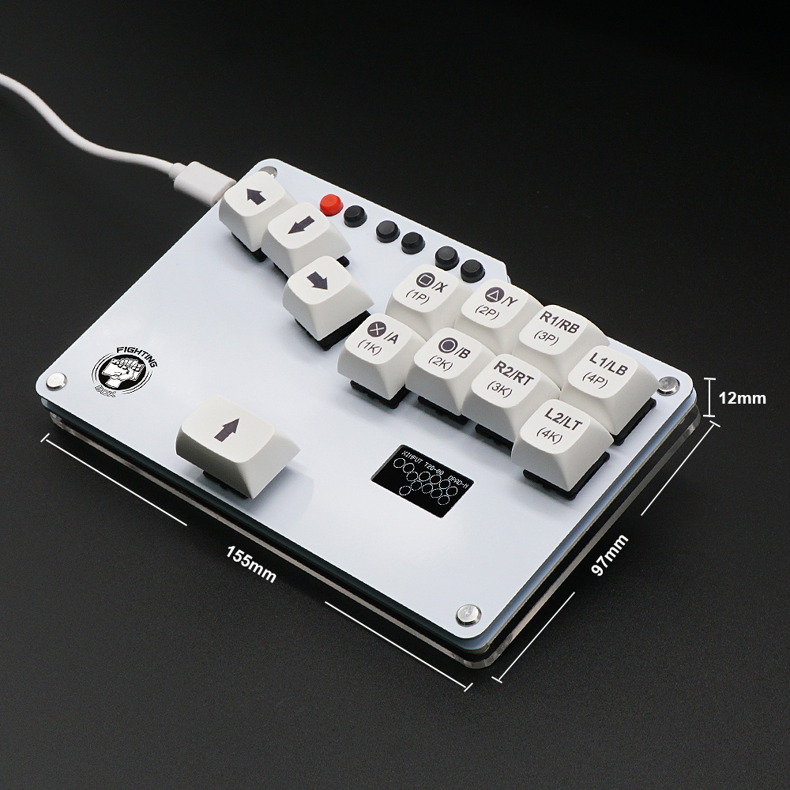
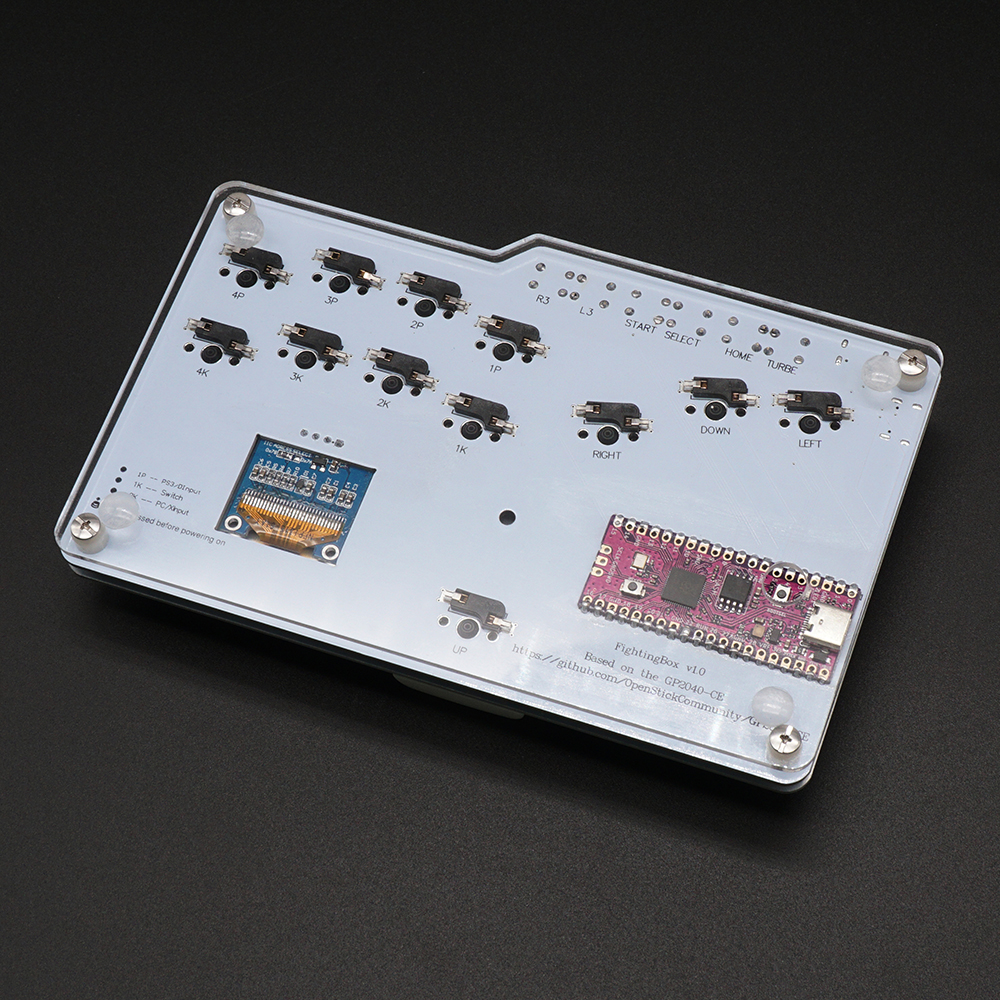
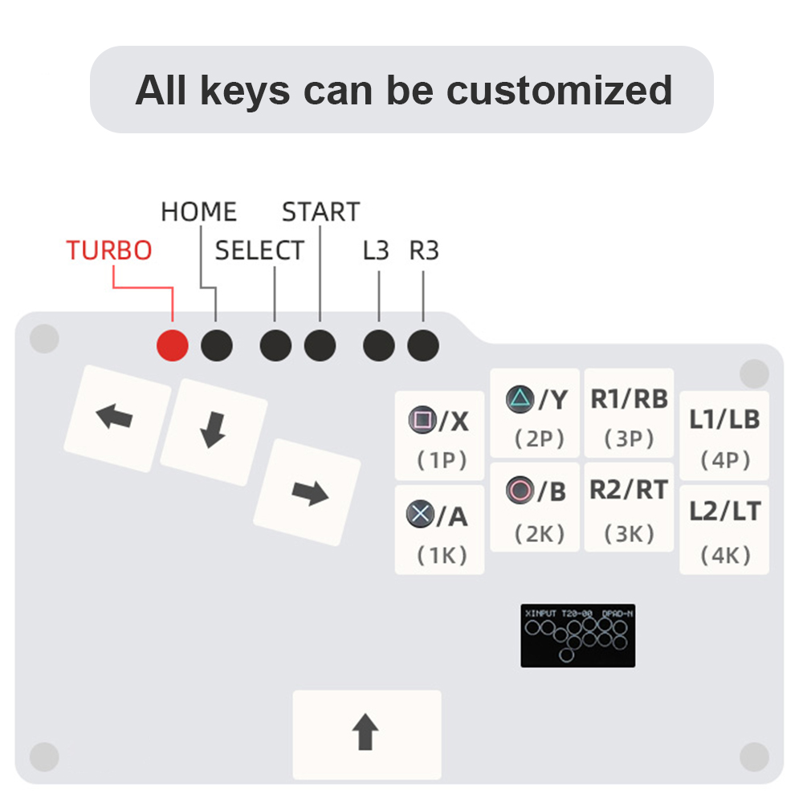
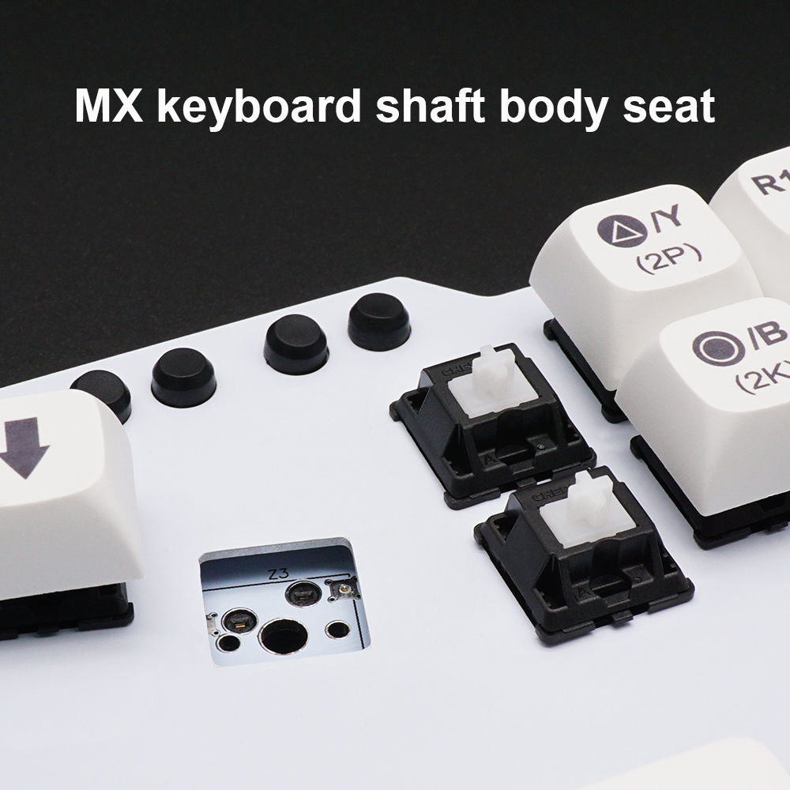
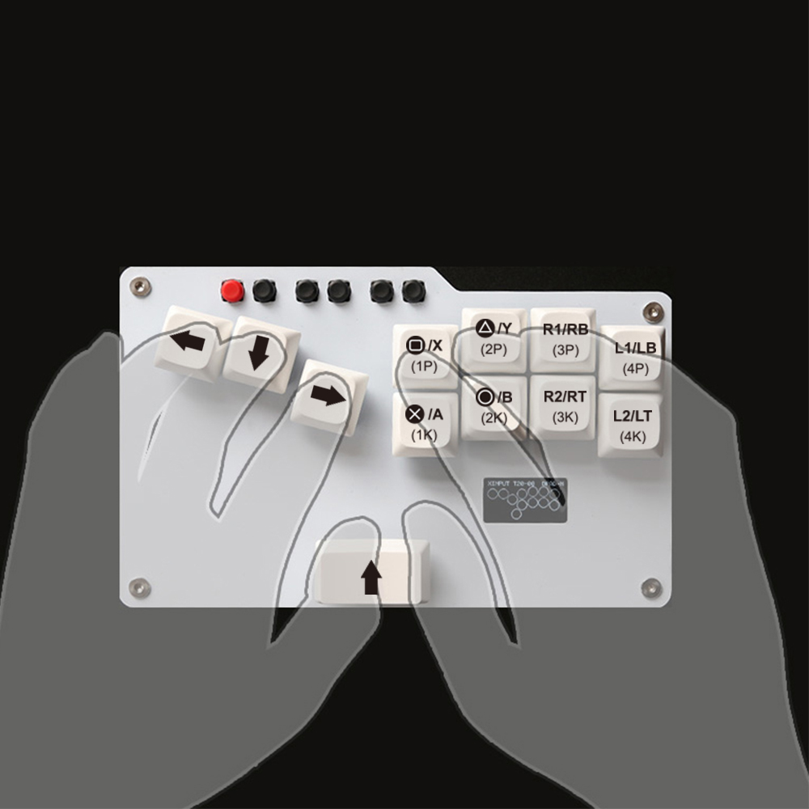
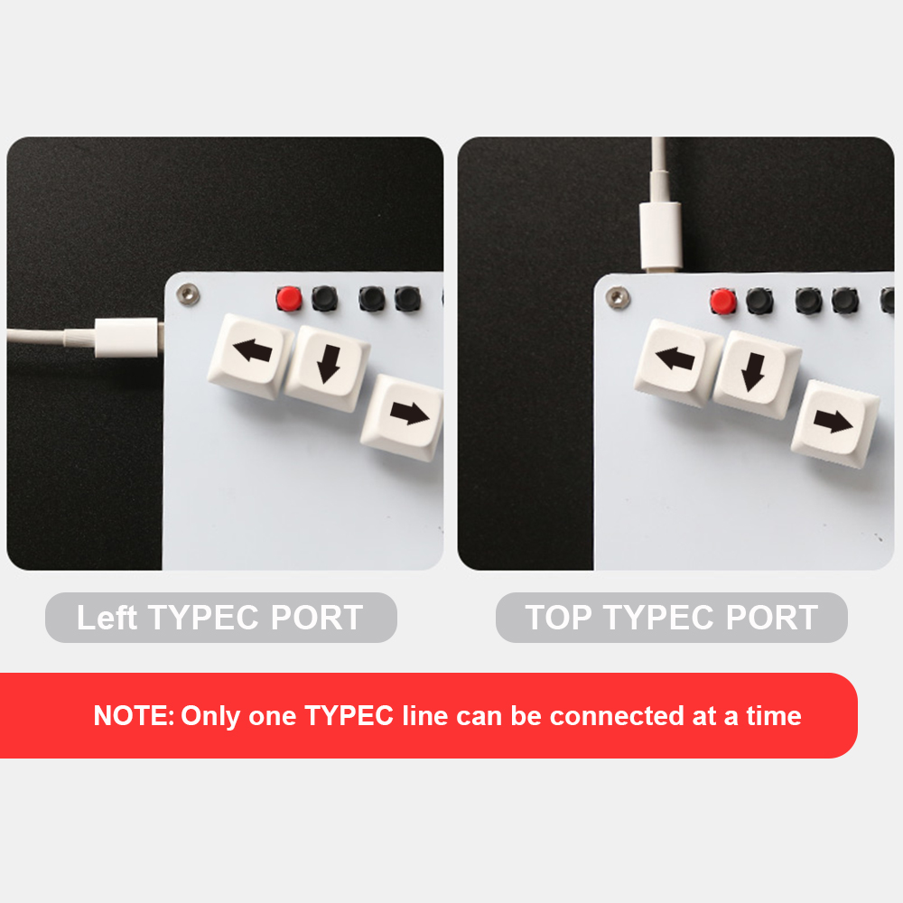
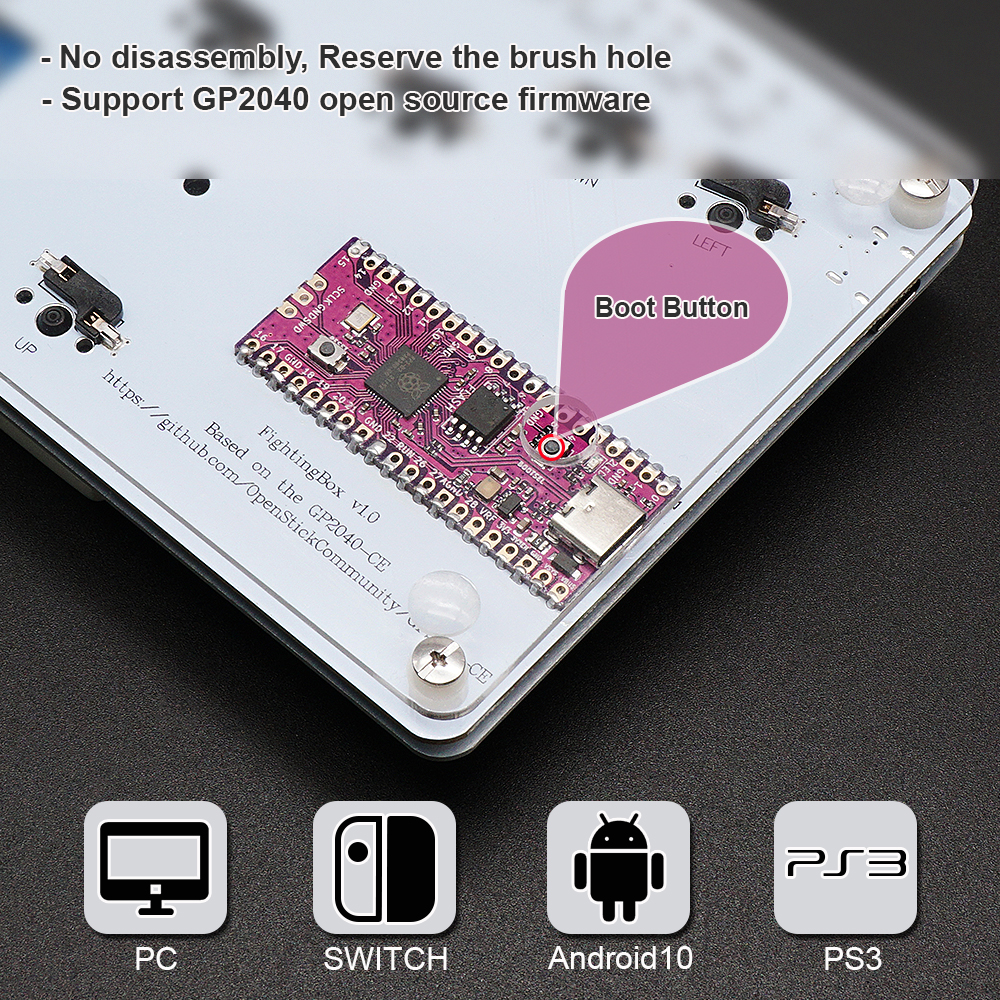
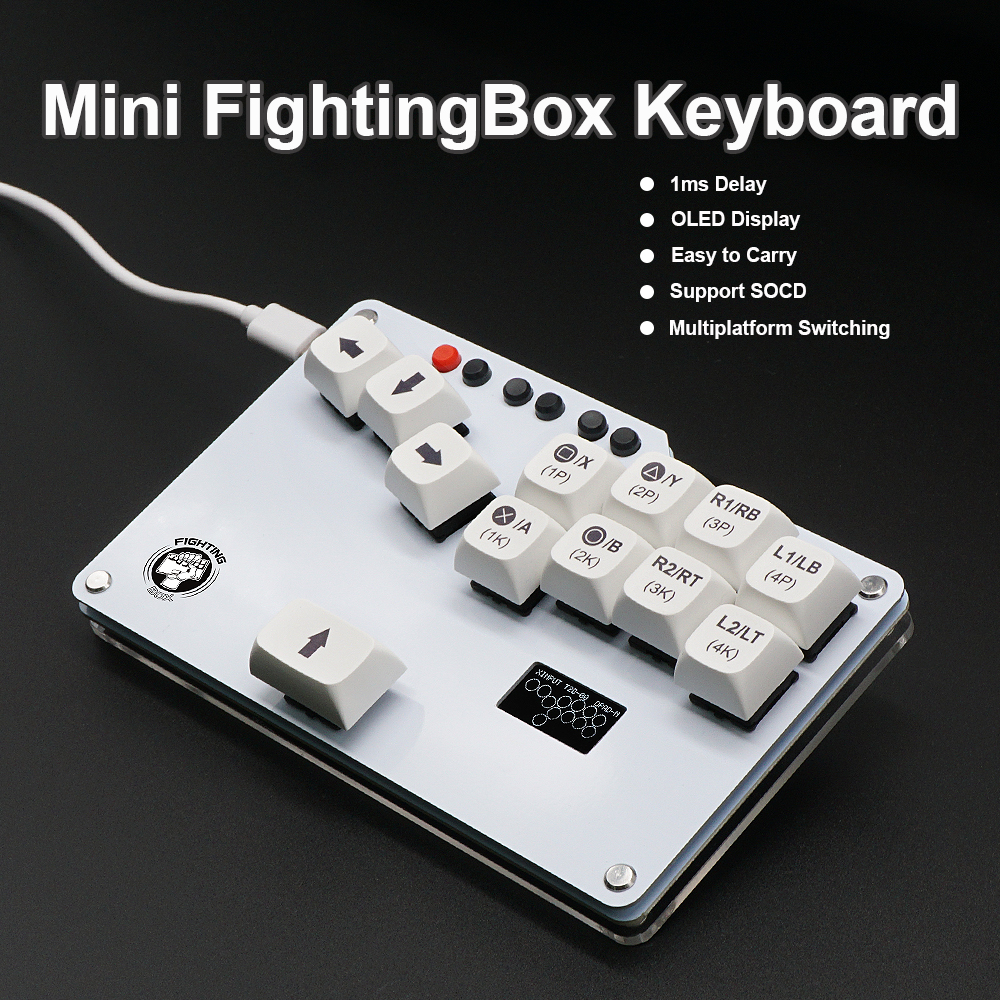

# GP2040-CE for Bitfunx FightingBox V1.0

[](https://github.com/Thoxy67/GP2040CE-FightingBoxV1/actions/workflows/build.yml)
[](https://github.com/Thoxy67/GP2040CE-FightingBoxV1/releases)

Up-to-date [GP2040-CE](https://gp2040-ce.info/) firmware for the **Bitfunx FightingBox V1.0**, a cheap AliExpress hitbox-style controller whose stock firmware is no longer maintained.

<p align="center">
  
  
</p>

## Features

- Latest GP2040-CE: works on PC, Switch, PS3/PS4/PS5, Xbox, and more
- All buttons mapped to the original board wiring
- OLED display support, with an on-screen layout that matches the physical buttons
- Custom boot logo:

  

## Install

1. Download the latest `.uf2` from [Releases](https://github.com/Thoxy67/GP2040CE-FightingBoxV1/releases).
2. Hold **UP + S1 + S2** while plugging in the USB cable. A drive named `RPI-RP2` appears.
3. Copy the `.uf2` onto that drive. The controller reboots by itself, and that's it.

| Hold while plugging in | Mode |
|---|---|
| `UP + S1 + S2` | Flash mode (firmware update) |
| `S1 + S2` | Web configurator at <http://192.168.7.1> |

> **Updating from an old firmware?** If buttons or the screen act strangely, reset the settings in the web configurator.

## Button mapping

| GPIO | Button | GPIO | Button | GPIO | Button |
|---:|---|---:|---|---:|---|
| 0 | Left  | 7  | B3 | 13 | R2 |
| 1 | Up    | 8  | B4 | 14 | L2 |
| 2 | Down  | 9  | R1 | 21 | L3 |
| 3 | Right | 10 | L1 | 22 | R3 |
| 4 | A1 (Home) | 11 | B1 | 28 | A2 (Capture) |
| 5 | S1 (Select) | 12 | B2 | 26 / 27 | OLED SDA / SCL |
| 6 | S2 (Start) | | | | |

Everything can be remapped in the web configurator.

## Build from source

Install the tools. See the [GP2040-CE build guide](https://gp2040-ce.info/development/build-environment/) for more details.

```bash
# Arch
sudo pacman -S git cmake arm-none-eabi-gcc arm-none-eabi-newlib nodejs npm
# Ubuntu / Debian
sudo apt install git cmake build-essential gcc-arm-none-eabi libnewlib-arm-none-eabi libstdc++-arm-none-eabi-newlib nodejs npm
```

Then build:

```bash
make                          # latest GP2040-CE
make GP2040_REF=v0.7.12       # a specific GP2040-CE version
make GP2040_DIR=~/GP2040-CE   # use your own GP2040-CE checkout
make clean
```

The firmware is written to `build/out/`. The board configuration is in [`configs/FightingBoxV1/BoardConfig.h`](configs/FightingBoxV1/BoardConfig.h).

CI builds every push, runs a weekly build against upstream to catch breaking changes, and publishes a release for each `v*` tag.

## Gallery

<details>
<summary>More photos</summary>








</details>

## License

MIT, see [LICENSE](LICENSE). Provided as-is; test before using it in competitive play.
